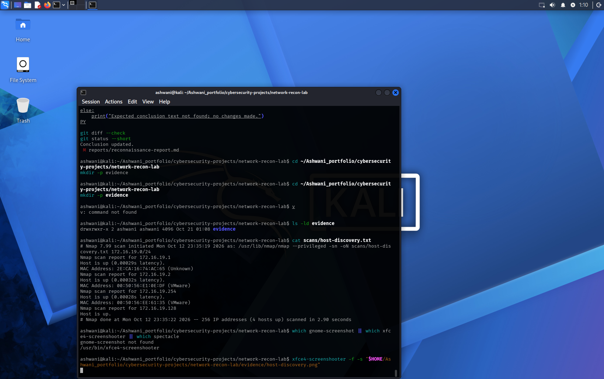
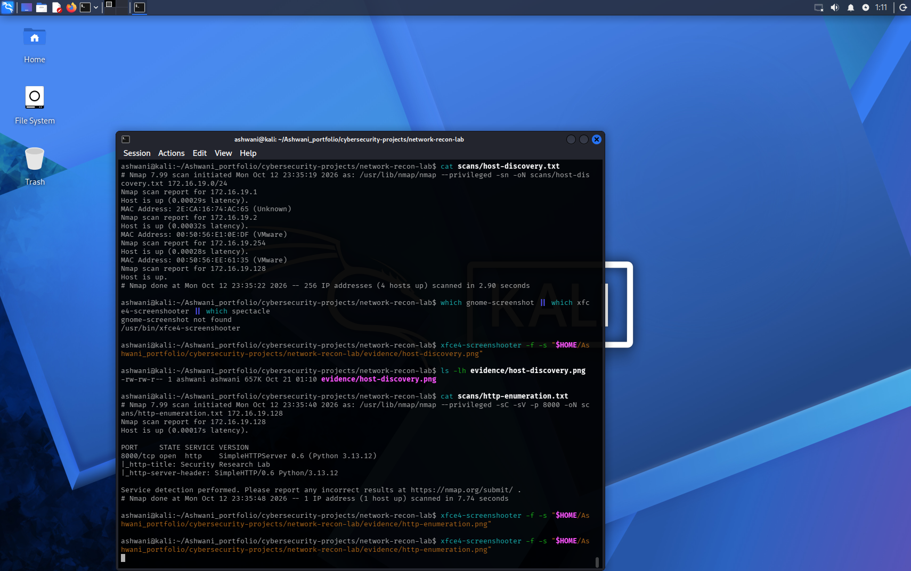
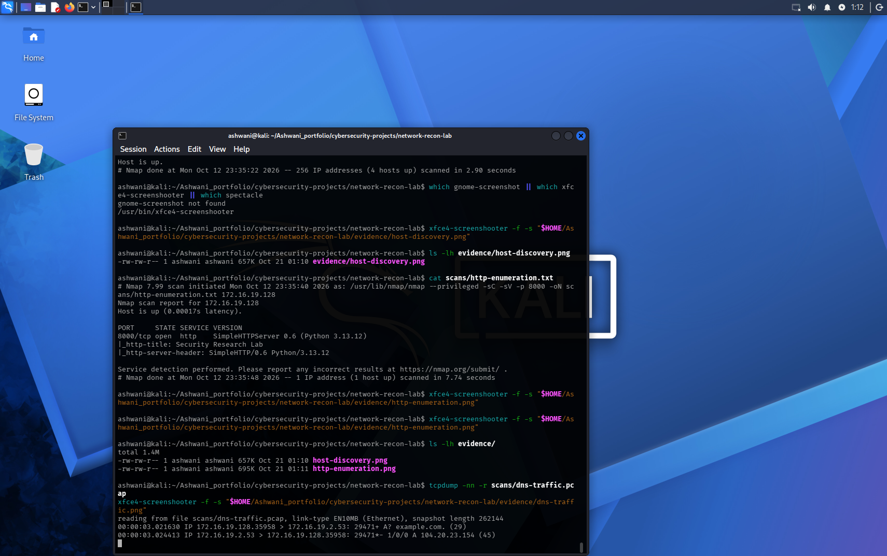

# Network Reconnaissance and Service Enumeration Lab

## Overview
A hands-on networking and reconnaissance lab covering host discovery, TCP port scanning, HTTP service enumeration, DNS queries, packet capture, and IPv4 subnetting fundamentals.

## Objectives
- Discover responsive hosts in an authorized virtual lab network.
- Enumerate HTTP services, methods, and response headers.
- Compare TCP scan results and document observed differences.
- Perform DNS A and MX record lookups.
- Capture and inspect DNS traffic.
- Practice IPv4 subnetting.

## Environment
- Platform: Kali Linux virtual machine
- Network interface: eth0
- Lab IP at time of testing: 172.16.19.128/24
- Tools: Nmap, curl, dig, tcpdump, Linux networking utilities

## Evidence
See the `scans/` directory for scan outputs, DNS evidence, and subnetting calculations.

## Report
See [Reconnaissance Report](reports/reconnaissance-report.md).

## Scope and Ethics
Educational testing in a virtual lab. Scan only systems for which you have authorization.

## Limitations
Results reflect the lab configuration at the time of testing. Unresolved observations are documented without assuming unverified causes.

## Evidence Screenshots

### Host Discovery

### HTTP Service Enumeration

### DNS Packet Capture

## Evidence Screenshots

### Host Discovery

### HTTP Service Enumeration

### DNS Packet Capture

